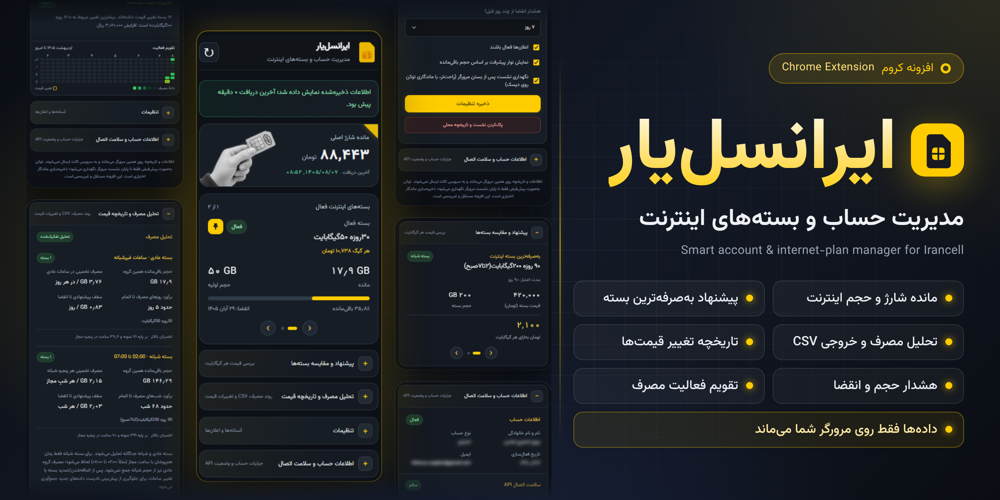
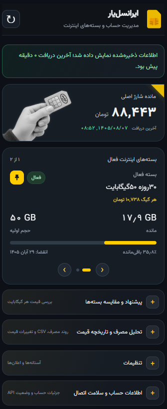
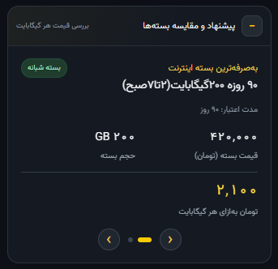
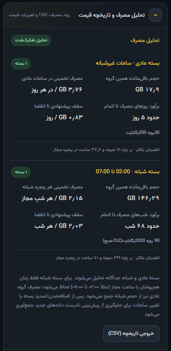
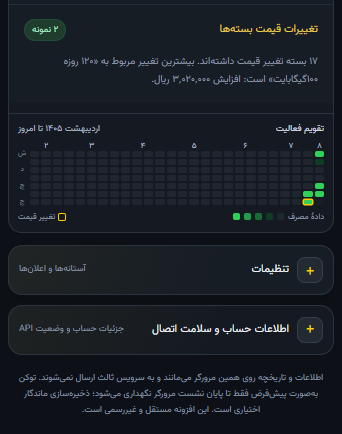
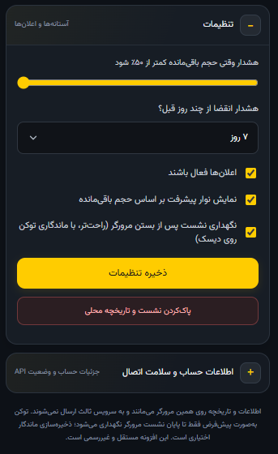
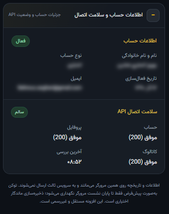
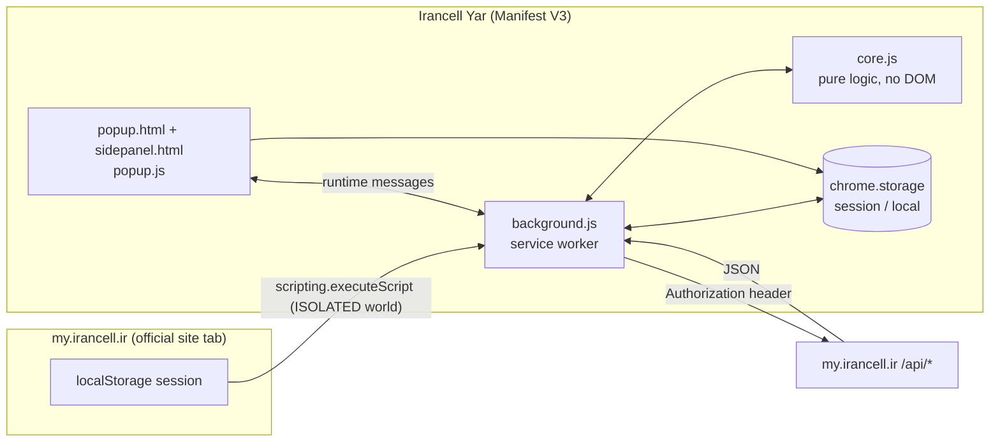
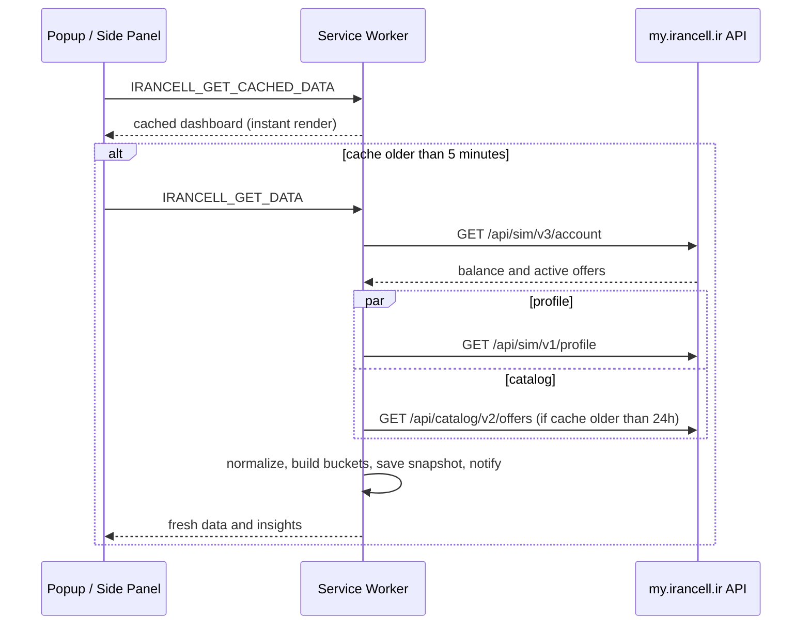

<p align="center">
  
</p>

<p align="center">
  
  
  
  
  
  
</p>

<h1 align="center">ایرانسل‌یار | Irancell-yar</h1>

<p align="center">
  داشبورد فارسی و محلیِ حساب و بسته‌های اینترنت ایرانسل، به‌صورت افزونه Chrome / Chromium
</p>

<p align="center">
  <a href="#overview">معرفی</a> ·
  <a href="#screenshots">تصاویر</a> ·
  <a href="#features">قابلیت‌ها</a> ·
  <a href="#install">نصب</a> ·
  <a href="#how-it-works">نحوه کار</a> ·
  <a href="#analytics">منطق تحلیل مصرف</a> ·
  <a href="#privacy">حریم خصوصی و امنیت</a> ·
  <a href="#development">توسعه</a> ·
  <a href="#troubleshooting">عیب‌یابی</a>
</p>

---

<a id="overview"></a>

## معرفی

**ایرانسل‌یار** یک افزونه سبک برای Chrome و مرورگرهای مبتنی بر Chromium است که اطلاعات حساب شما در [My Irancell](https://my.irancell.ir/) را در یک داشبورد فارسی، راست‌چین و تیره نمایش می‌دهد و چند کار را که به‌طور معمول باید دستی انجام دهید، خودکار می‌کند:

- مانده شارژ و **بسته‌های فعال اینترنت** را یک‌جا و با درصد مصرف و تاریخ انقضا می‌بینید.
- **به‌صرفه‌ترین بسته** (بر پایه قیمت هر گیگابایت) را برای بسته‌های عادی و شبانه جدا پیدا می‌کند.
- **روند مصرف** را برای بسته عادی و بسته شبانه *جداگانه* تحلیل می‌کند و برآورد می‌دهد حجمتان چند روز یا چند شب دیگر دوام می‌آورد.
- **تغییر قیمت بسته‌ها** و **تاریخچه شارژ** را به‌صورت محلی ثبت می‌کند و نمودار و تقویم فعالیت نشان می‌دهد.
- قبل از کم‌شدن حجم یا رسیدن انقضا **اعلان** می‌فرستد.

همه‌چیز روی مرورگر خودتان اتفاق می‌افتد: افزونه سرور، سرویس تحلیلی یا CDN ندارد و فقط با `https://my.irancell.ir` ارتباط برقرار می‌کند.

> **English:** Irancell Yar is a Persian, dark-themed, local-first Chrome (Manifest V3) extension that turns your My Irancell account data into a dashboard: active data packages, cheapest price-per-GB offers, separate usage forecasts for regular and night bundles, price-change history, alerts and CSV export. It is an **unofficial** project and sends nothing anywhere except to `my.irancell.ir`.

<a id="screenshots"></a>

## تصاویر

<table>
  <tr>
    <td align="center" valign="top" width="33%">
      <br>
      <sub><b>داشبورد اصلی</b><br>مانده شارژ، بسته‌های فعال، درصد مصرف و انقضا</sub>
    </td>
    <td align="center" valign="top" width="33%">
      <br>
      <sub><b>پیشنهاد و مقایسه بسته‌ها</b><br>به‌صرفه‌ترین بسته عادی و شبانه بر اساس قیمت هر گیگابایت</sub>
    </td>
    <td align="center" valign="top" width="33%">
      <br>
      <sub><b>تحلیل مصرف</b><br>تفکیک بسته عادی و شبانه، سقف پیشنهادی و خروجی CSV</sub>
    </td>
  </tr>
  <tr>
    <td align="center" valign="top">
      <br>
      <sub><b>تغییرات قیمت و تقویم فعالیت</b><br>تقویم شمسی با نمایش روزهای ثبت مصرف و تغییر قیمت</sub>
    </td>
    <td align="center" valign="top">
      <br>
      <sub><b>تنظیمات</b><br>آستانه هشدار حجم و انقضا، اعلان‌ها، نگهداری نشست</sub>
    </td>
    <td align="center" valign="top">
      <br>
      <sub><b>اطلاعات حساب و سلامت اتصال</b><br>مقادیر حساب به‌صورت پیش‌فرض محو هستند و با هاور نمایش داده می‌شوند</sub>
    </td>
  </tr>
</table>

<a id="features"></a>

## قابلیت‌ها

### داشبورد حساب و بسته‌ها

- **مانده شارژ اصلی** به تومان (مقدار ریالیِ API بر ۱۰ تقسیم می‌شود) همراه با زمان آخرین دریافت.
- **کاروسل بسته‌های فعال اینترنت** با حجم کل، حجم باقی‌مانده، درصد مصرف و تاریخ انقضا. نوار پیشرفت به‌صورت پیش‌فرض درصد *مصرف‌شده* را نشان می‌دهد و از تنظیمات می‌توان آن را روی *باقی‌مانده* گذاشت.
- **سنجاق‌کردن بسته (Pin):** هر بسته فعال را می‌توان در اولویت اول کاروسل نگه داشت؛ انتخاب شما بعد از بازکردن دوباره و تازه‌سازی هم می‌ماند و با کلیک دوباره برداشته می‌شود.
- **قیمت هر گیگ بسته فعال:** اگر API قیمت بسته فعال را نداده باشد، افزونه نزدیک‌ترین بسته مشابه را در کاتالوگ پیدا می‌کند و قیمت هر گیگ را از روی آن حساب می‌کند. اگر بسته مشابهِ قابل‌اعتماد پیدا نشود، به‌جای حدس‌زدن، صریحاً «قیمت بسته مشابه پیدا نشد» نشان می‌دهد.
- **دو حالت نمایش:** پنجره کوچک (popup) برای نگاه سریع، و **سایدبار** دائمی که کنار صفحات وب باز می‌ماند و با جابه‌جایی تب‌ها بسته نمی‌شود.
- **نمایش فوری، به‌روزرسانی بعد:** با بازکردن افزونه ابتدا آخرین داده ذخیره‌شده نشان داده می‌شود و فقط اگر بیش از ۵ دقیقه از آن گذشته باشد در پس‌زمینه تازه می‌شود (stale‑while‑revalidate).

### پیشنهاد و مقایسه بسته‌ها

- کاتالوگ بسته‌های اینترنت از API خوانده و **قیمت هر گیگابایت** برای همه بسته‌ها محاسبه می‌شود.
- **ارزان‌ترین بسته عادی** و **ارزان‌ترین بسته شبانه** جدا رتبه‌بندی می‌شوند، چون مقایسه یک بسته ۲۴ ساعته با بسته‌ای که فقط ساعت‌های مشخصی قابل مصرف است منصفانه نیست.
- برای هر پیشنهاد، قیمت، حجم، مدت اعتبار و قیمت هر گیگ نشان داده می‌شود.
- کاتالوگ حداکثر هر **۲۴ ساعت** یک بار دریافت می‌شود و در صورت خطا، تا ۱۰ دقیقه درخواست تکراری ارسال نمی‌شود.

### تحلیل مصرف (تفکیک‌شده بر اساس نوع بسته)

- بسته‌های **عادی** و **شبانه** هرگز با هم جمع نمی‌شوند؛ هر «سبد» مانده، نرخ مصرف و زمان اتمام مستقل دارد.
- بسته‌های شبانه با **بازه ساعتی یکسان** (مثلاً ۰۲:۰۰ تا ۰۷:۰۰) در یک گروه قرار می‌گیرند؛ بازه‌های متفاوت، کارت جدا دارند.
- خروجی هر سبد: حجم باقی‌مانده، **مصرف تخمینی** (در روز، یا در هر شب مجاز)، **زمان تقریبی اتمام**، **سقف پیشنهادی مصرف تا انقضا** و **سطح اطمینان** (بر پایه تعداد نمونه و ساعت‌های مشاهده‌شده).
- وقتی داده کافی نیست (یا عنوان بسته ساعت دقیق را نمی‌گوید)، افزونه **عدد نمی‌سازد** و علت را توضیح می‌دهد.
- جزئیات الگوریتم در بخش [منطق تحلیل مصرف](#analytics) آمده است.

### تاریخچه و نمودارها

- **تاریخچه مصرف:** تا ۱۵۰۰ نمونه محلی؛ رابط کاربری فقط ۹۶ نمونه اخیر را دریافت می‌کند ولی خروجی CSV کل تاریخچه را شامل می‌شود.
- **تغییرات قیمت بسته‌ها:** تا ۴۵ نمونه از کاتالوگ (هنگام تغییر یا حداکثر روزی یک بار)؛ افزونه دو نمونه آخر را مقایسه و بیشترین تغییر قیمت را گزارش می‌کند.
- **تقویم فعالیت شمسی:** شدت رنگ هر خانه = تعداد رکوردهای تحلیل مصرف همان روز؛ حاشیه زرد = تغییر قیمت ثبت‌شده در همان روز.
- **نمودار تاریخچه شارژ (sparkline):** از گوشه زرد کارت مانده شارژ باز می‌شود. روزی یک نقطه (به وقت تهران)، تا ۷۳۰ روز نگهداری و ۳۰ روز اخیر نمایش داده می‌شود.
- **خروجی CSV** با BOM مناسب Excel و محافظت در برابر تزریق فرمول؛ ستون‌ها در بخش [خروجی CSV](#csv) آمده‌اند.

### هشدارها

- **کمبود حجم:** برای هر سبد (عادی / هر بازه شبانه) جدا بررسی می‌شود؛ بسته شبانه بزرگ نمی‌تواند کمبود بسته عادی را بپوشاند و برعکس.
- **نزدیک‌شدن به انقضا:** برای هر بسته با تاریخ انقضای خودش.
- **نشست منقضی‌شده:** اعلان ورود مجدد؛ با کلیک روی آن صفحه ورود My Irancell باز می‌شود.
- هر هشدار فقط **یک بار** برای همان شرایط ارسال می‌شود (دفتر ثبت اعلان‌ها تا ۲۰۰ مورد).

### سلامت اتصال و مدیریت خطا

- پنل «اطلاعات حساب و سلامت اتصال» وضعیت آخرین درخواست‌های **حساب، پروفایل و کاتالوگ** و زمان آخرین بررسی را نشان می‌دهد.
- خطاها جداگانه و گویا گزارش می‌شوند: نشست منقضی، محدودیت درخواست (429)، خطای سرور، پاسخ نامعتبر / تغییر ساختار API، قطع اتصال و timeout.
- خطای 403 به‌تنهایی «VPN روشن است» تلقی نمی‌شود و نشست را هم پاک نمی‌کند.
- مقادیر حساس بخش حساب (نام، ایمیل و …) به‌صورت پیش‌فرض **محو** هستند و فقط با هاور یا فوکوس دیده می‌شوند.

<a id="install"></a>

## نصب

> افزونه فعلاً در فروشگاه Chrome منتشر نشده و به‌صورت **Load unpacked** نصب می‌شود.

**پیش‌نیاز:** Chrome (یا مرورگر Chromium سازگار) نسخه **116 یا بالاتر**؛ حداقل نسخه به‌خاطر `sidePanel.open()` است.

1. این مخزن را دریافت کنید (**Code → Download ZIP** یا فایل ZIP نسخه‌ها) و در یک پوشه ثابت استخراج کنید.
2. در مرورگر به `chrome://extensions` بروید و **Developer mode** را روشن کنید.
3. روی **Load unpacked** بزنید و پوشه‌ای را انتخاب کنید که `manifest.json` **مستقیماً** داخل آن است.
4. سایت [my.irancell.ir](https://my.irancell.ir/) را باز کنید و وارد حساب خود شوید.
5. روی آیکون ایرانسل‌یار کلیک کنید تا اطلاعات دریافت شود.
6. برای داشبورد ماندگار، در پنجره افزونه روی دکمه **◨ بازکردن داشبورد در سایدبار** بزنید.

پس از ثبت یک نشست معتبر، لازم نیست تب سایت باز بماند. اگر نشست منقضی شد، دوباره وارد سایت شوید و افزونه را باز کنید. برای به‌روزرسانی دستی نسخه، در `chrome://extensions` روی **Reload** بزنید.

> [!TIP]
> برای اینکه تحلیل مصرف و برآورد اتمام حجم دقیق‌تر شود، افزونه باید در طول چند ساعت و چند روز نمونه جمع کند. هرچه بیشتر از آن استفاده کنید، برآوردها قابل‌اعتمادتر می‌شوند.

<a id="how-it-works"></a>

## نحوه کار



۱. **دریافت نشست.** هر بار که تبی از `my.irancell.ir` بارگذاری شود (یا هنگام نصب / درخواست دستی)، سرویس‌ورکر با `chrome.scripting` و در **ISOLATED world** نشست ورود موجود در `localStorage` همان سایت را می‌خواند. توکن فقط در `chrome.storage` افزونه نگهداری می‌شود، نه در لاگ و نه در پیام‌های رابط کاربری.

۲. **درخواست API.** سرویس‌ورکر به ترتیب حساب را می‌خواند؛ اگر نشست معتبر بود، **پروفایل** و **کاتالوگ** را هم (کاتالوگ فقط در صورت قدیمی‌بودن کش ۲۴ ساعته) به‌صورت موازی می‌گیرد. هر درخواست timeout ۱۴ ثانیه‌ای دارد و در خطای شبکه یا پاسخ 429 / 5xx حداکثر ۳ بار با backoff نمایی و jitter تکرار می‌شود (با احترام محدود به `Retry-After`).

۳. **نرمال‌سازی و تحلیل.** `core.js` پاسخ را اعتبارسنجی می‌کند، بسته‌ها را به سبدهای عادی / شبانه تقسیم می‌کند، نمونه جدید می‌سازد و روند مصرف را حساب می‌کند.

۴. **ذخیره و اعلان.** نمونه، تاریخچه قیمت، دفتر روزانه شارژ و کش داشبورد ذخیره و در صورت لزوم اعلان ارسال می‌شود.

۵. **نمایش.** popup و سایدبار از **یک** `popup.js` مشترک استفاده می‌کنند و با `storage.onChanged` هماهنگ می‌مانند.



علاوه بر رابط کاربری، یک **alarm** هر ۳۰ دقیقه بررسی دوره‌ای انجام می‌دهد و هنگام راه‌اندازی مرورگر هم یک دریافت انجام می‌شود. اگر نشست معتبر وجود نداشته باشد یا ۴۰۱ برگردد، بررسی خودکار متوقف می‌شود (تا ورود مجدد) تا درخواست بی‌فایده ارسال نشود.

### منابع داده

<div dir="rtl">

| کاربرد | درخواست | ملاحظات |
|---|---|---|
| مانده حساب و بسته‌های فعال | `GET /api/sim/v3/account` | ابتدا همین درخواست اجرا می‌شود؛ ساختار پاسخ سخت‌گیرانه اعتبارسنجی می‌شود |
| پروفایل | `GET /api/sim/v1/profile` | نام، نوع حساب، تاریخ فعال‌سازی، ایمیل (برای پنل حساب) |
| کاتالوگ بسته‌های اینترنت | `GET /api/catalog/v2/offers?type=data&category=normal` | حداکثر هر ۲۴ ساعت؛ تا ۱۲۰۰ پیشنهاد در کش ذخیره می‌شود |

</div>

همه درخواست‌ها به `https://my.irancell.ir` می‌روند و سرآیند `Authorization`، `x-app-version` (از خود سایت خوانده می‌شود) و `Accept-Language: fa` دارند.

> [!IMPORTANT]
> این endpointها **API عمومی و مستندشده** نیستند؛ از رفتار مشاهده‌شده سایت رسمی استخراج شده‌اند و ممکن است بدون اطلاع قبلی تغییر کنند. فرض‌های واحد: مبالغ و قیمت‌ها **ریال**، حجم‌ها **MiB** و تبدیل به گیگابایت بر ۱۰۲۴ است. اگر عددی با نمایش رسمی سایت نمی‌خواند، این فرض‌ها را بازبینی کنید.

<a id="analytics"></a>

## منطق تحلیل مصرف

این بخش برای کسانی است که می‌خواهند بدانند اعداد از کجا می‌آیند. پیاده‌سازی در `core.js` است.

### ۱. تشخیص بسته شبانه و بازه ساعتی

هر بسته فعال بر اساس **عنوان** (و برچسب‌های مرتبط) طبقه‌بندی می‌شود: عباراتی مثل «شبانه»، «بامداد»، «نیمه‌شب»، `night` یا الگوهایی مثل «۲ تا ۷ صبح» و `02:00 to 07:00`. ارقام فارسی و عربی نرمال می‌شوند.

اگر عنوان ساعت دقیق داشته باشد، بازه استخراج می‌شود:

| عنوان نمونه | شبانه؟ | بازه |
|---|---|---|
| `۹۰ روزه ۲۰۰گیگابایت(۲تا۷صبح)` | بله | 02:00 تا 07:00 |
| `اینترنت شبانه 00:00 تا 06:00` | بله | 00:00 تا 06:00 |
| `بسته شبانه ۳۰ روزه ۵۰ گیگابایت` | بله | **نامشخص** ← پیش‌بینی غیرفعال |
| `۳۰روزه ۵۰گیگابایت` | خیر | بسته عادی |

> تشخیص بر پایه عنوان است و قطعی نیست؛ تا زمانی که API فیلد زمان‌بندی ساختاریافته ندهد، ساعت شبانه **حدس زده نمی‌شود**.

### ۲. سبدها (Buckets)

- **سبد عادی:** همه بسته‌های غیرشبانه. اگر بازه شبانه معلوم باشد، آن ساعت‌ها از «زمان قابل مصرف» کم می‌شود (مثلاً ۲۴ − ۵ = ۱۹ ساعت). اگر بسته شبانه فعالی با ساعت نامعلوم وجود داشته باشد، سبد عادی هم از نظر زمانی قابل تفکیک نیست و پیش‌بینی آن متوقف می‌شود.
- **سبد شبانه:** هر بازه یکسان، یک سبد.
- مانده هر سبد فقط از **مانده خود بسته‌ها** (`remained_amount` و معادل‌ها) جمع می‌شود. فیلد کلی `global_data_remaining` عمداً به هیچ بسته‌ای نسبت داده نمی‌شود، چون ممکن است مجموع حساب باشد و تکثیرش مانده را چندبرابر کند. در نبود مانده مستقل، رابط «نامشخص» نشان می‌دهد.

### ۳. برآورد مصرف

برای هر سبد:

1. نمونه‌های ۱۴ روز اخیر با همان **امضای بسته** (شناسه، نام، حجم کل، انقضا) و همان زمان‌بندی انتخاب می‌شوند.
2. با دیدن **افزایش مانده** (مثلاً خرید یا تمدید)، بخش قبلی کنار گذاشته می‌شود و از همان نقطه دوباره مبناگذاری می‌شود.
3. هر فاصله بین دو نمونه (حداکثر ۷ روز) بر اساس **هم‌پوشانی واقعی با ساعت‌های مجاز** به وقت ایران وزن می‌گیرد. برای بسته عادی، افتی که بازه‌اش از مرز شبانه عبور کند به روز نسبت داده نمی‌شود و آن جفت نمونه کنار می‌رود.
4. اگر حداقل **۳ نمونه**، **۲ فاصله معتبر** و **۲ ساعت** مشاهده در ساعت‌های مجاز وجود داشته باشد:

   ```text
   usage_per_cycle   = (observed_consumption / eligible_hours_observed) * eligible_hours_per_cycle
   cycles_to_exhaust = bucket_remaining / usage_per_cycle
   ```

   یعنی مصرف مشاهده‌شده بر ساعت‌های مجازِ مشاهده‌شده تقسیم می‌شود (نرخ ساعتی)، در ساعت‌های مجازِ هر دوره ضرب می‌شود، و مانده سبد بر آن تقسیم می‌شود. «دوره» برای سبد عادی یک **روز** و برای سبد شبانه یک **شب** است (مثلاً ۵ ساعت برای 02:00 تا 07:00).

| سطح اطمینان | شرط (شبانه) | شرط (عادی) |
|---|---|---|
| بالاتر | ≥ ۶ نمونه و ≥ ۸ ساعت مشاهده | ≥ ۶ نمونه و ≥ ۲۴ ساعت مشاهده |
| متوسط | ≥ ۳ نمونه و ≥ ۲ ساعت | ≥ ۳ نمونه و ≥ ۴ ساعت |
| تخمینی؛ نمونه کم | سایر حالت‌ها | سایر حالت‌ها |

### ۴. سقف پیشنهادی مصرف تا انقضا

برای هر بسته در سبد، «مانده ÷ تعداد دوره‌های باقی‌مانده تا انقضا» حساب و بین بسته‌های سبد جمع می‌شود. برای سبد شبانه، تعداد **شب‌های مجاز** تا انقضا شمرده می‌شود؛ برای سبد عادی، تعداد روزها. اگر تاریخ انقضا یا بازه کافی نباشد، پیام توضیحی نشان داده می‌شود.

### ۵. قیمت هر گیگ و رتبه‌بندی

```text
price_per_gb_rial = price / (volume_mib / 1024)
price_per_gb_toman = price_per_gb_rial / 10        # display value
```

رتبه‌بندی «به‌صرفه‌ترین» فقط **قیمت اسمی** واحد حجم را مقایسه می‌کند و شرایط اختصاصی شما، مالیات یا هزینه‌های احتمالی، محدودیت ساعت و امکان خرید واقعی هر پیشنهاد را تضمین نمی‌کند.

برای بسته فعالی که قیمت ندارد، پیشنهاد کاتالوگ فقط وقتی «مشابه» حساب می‌شود که اختلاف حجم‌اش حداکثر ۳٫۵٪ باشد و **یکی** از این دو برقرار باشد: شباهت واژه‌های نام دو بسته دست‌کم ۲۵٪ است، یا حجم‌ها تقریباً برابرند (اختلاف حداکثر ۰٫۵٪) و هر دو هم‌دسته‌اند (روزانه / شبانه). در میان نامزدها، بالاترین امتیاز شباهت انتخاب می‌شود.

<a id="csv"></a>

### خروجی CSV

از «تحلیل مصرف و تاریخچه قیمت» ← **خروجی تاریخچه (CSV)**. نام فایل `irancell-yaar-history-YYYY-MM-DD.csv` است و ستون‌ها این‌ها هستند:

| # | ستون |
|---|---|
| 1 | زمان نمونه (ISO) |
| 2 | زمان نمونه (شمسی، تهران) |
| 3 | مانده ریالی |
| 4 | حجم کل MiB (صرفاً نمایشی) |
| 5 | حجم باقی‌مانده کل MiB (مبنای پیش‌بینی نیست) |
| 6 | مصرف پیش‌بینی‌شده عادی (MiB در روز) |
| 7 | مانده عادی MiB |
| 8 | روزهای مصرف عادی تا اتمام |
| 9 | تحلیل بسته‌های شبانه (پنجره؛ مانده MiB؛ MiB در هر شب؛ شب تا اتمام) |
| 10 | تعداد بسته فعال |
| 11 | نام بسته‌ها |
| 12 | نزدیک‌ترین انقضا |

<a id="privacy"></a>

## حریم خصوصی و امنیت

### چه چیزی کجا ذخیره می‌شود؟

| کلید | محتوا | محل | سقف |
|---|---|---|---|
| `irancellSession` | توکن دسترسی | `storage.session` (پیش‌فرض) یا `storage.local` (اگر ماندگاری را فعال کنید) | ۱ نشست |
| `irancellHistory` | نمونه‌های مصرف (بسته‌ها، مانده، سبدها) | `storage.local` | ۱۵۰۰ نمونه |
| `irancellBalanceHistory` | دفتر روزانه مانده شارژ | `storage.local` | ۷۳۰ روز |
| `irancellCatalogHistory` | عکس‌های کاتالوگ برای تغییر قیمت | `storage.local` | ۴۵ نمونه × ۱۰۰ پیشنهاد |
| `irancellCatalogCache` | کش کاتالوگ (۲۴ ساعت) | `storage.local` | ۱۲۰۰ پیشنهاد |
| `irancellDashboardCache` | آخرین پاسخ حساب و پروفایل برای نمایش فوری | `storage.local` | ۱ مورد |
| `irancellSettings` | آستانه‌ها و گزینه‌ها | `storage.local` | — |
| `irancellPinnedActivePackage` | بسته سنجاق‌شده | `storage.local` | ۱ مورد |
| `irancellNotificationLedger` | دفتر اعلان‌های ارسال‌شده (برای جلوگیری از تکرار) | `storage.local` | ۲۰۰ مورد |
| `lastHealth`, `lastSuccessfulFetch`, `irancellPollingPaused`, `irancellRejectedTokenHash`, `irancellSchemaVersion`, `irancellAppVersion`, `irancellSessionMode` | وضعیت داخلی | `storage.local` | — |

### اصول

- **فقط یک مقصد شبکه:** `https://my.irancell.ir`. هیچ سرور تحلیلی، تبلیغاتی، سرویس ثالث، CDN، فونت یا اسکریپت راه‌دور وجود ندارد؛ فونت و تصاویر محلی هستند.
- **توکن به‌صورت پیش‌فرض موقت است** و با پایان نشست مرورگر پاک می‌شود. ذخیره ماندگار اختیاری و پیش‌فرض خاموش است. در هر دو حالت، `chrome.storage` در برابر بدافزاری که به پروفایل مرورگر دسترسی دارد **رمزنگاری‌شده نیست**؛ فقط روی دستگاه و پروفایل مورد اعتماد استفاده کنید.
- افزونه نشست را از `localStorage` همان سایت **می‌خواند** (کلید `NGMI-Sessions`) تا از طرف شما به API رسمی درخواست بزند؛ این خواندن فقط روی تب‌های مبدأ رسمی و در ISOLATED world انجام می‌شود.
- حافظه افزونه روی سطح `TRUSTED_CONTEXTS` تنظیم شده تا اگر در آینده content script اضافه شد، به آن دسترسی نداشته باشد.
- توکن و پاسخ کامل API در لاگ نوشته نمی‌شود. پس از 401، توکن ردشده با یک fingerprint محلی علامت می‌خورد تا دوباره استفاده نشود.
- خروجی CSV در برابر **تزریق فرمول** (مقادیر شروع‌شونده با `=`، `+`، `-`، `@`) ایمن شده است.
- برای پاک‌سازی، در «تنظیمات» گزینه **پاک‌کردن نشست و تاریخچه محلی** را بزنید: نشست، تاریخچه‌ها و کش‌ها حذف می‌شوند؛ تنظیمات هشدار می‌مانند.

متن کامل: [`PRIVACY-POLICY.md`](PRIVACY-POLICY.md)

### دسترسی‌ها (Permissions)

<div dir="rtl">

| دسترسی | چرا لازم است |
|---|---|
| `host_permissions: https://my.irancell.ir/*` | تنها مبدأ مجاز برای درخواست API و خواندن نشست |
| `scripting` | خواندن نشست موجود از تب رسمی (فقط همان مبدأ، ISOLATED world) |
| `storage` | کش، تاریخچه و تنظیمات محلی |
| `alarms` | بررسی دوره‌ای هر ۳۰ دقیقه |
| `notifications` | هشدار حجم / انقضا / نشست منقضی |
| `sidePanel` | داشبورد ماندگار در پنل کناری |

</div>

دسترسی عمومی `tabs` درخواست **نشده** است.

<a id="settings"></a>

## تنظیمات

<div dir="rtl">

| گزینه | محدوده | پیش‌فرض |
|---|---|---|
| هشدار وقتی حجم باقی‌مانده کمتر از … شود | ۵٪ تا ۵۰٪ (گام ۵) | ۲۰٪ |
| هشدار انقضا از چند روز قبل | ۱، ۳، ۵ یا ۷ روز | ۳ روز |
| اعلان‌ها فعال باشند | روشن / خاموش | روشن |
| نمایش نوار پیشرفت بر اساس حجم باقی‌مانده | روشن / خاموش | خاموش (نمایش مصرف‌شده) |
| نگهداری نشست پس از بستن مرورگر | روشن / خاموش | خاموش |

</div>

<a id="troubleshooting"></a>

## عیب‌یابی

<div dir="rtl">

| نشانه | علت محتمل و راه‌حل |
|---|---|
| «نشست پیدا نشد» | ابتدا در [my.irancell.ir](https://my.irancell.ir/) وارد شوید، سپس افزونه را دوباره باز کنید. |
| 401 / نشست منقضی | افزونه نشست قدیمی را پاک و در صورت وجود نشست متفاوت در تب رسمی، یک بار بازیابی می‌کند. در غیر این صورت دوباره وارد سایت شوید. |
| 403 یا خطای شبکه | اگر VPN/Proxy فعال است خاموشش کنید و اتصال و وضعیت ورود را بررسی کنید؛ این خطا دلایل دیگری هم می‌تواند داشته باشد. |
| «ساختار پاسخ API تغییر کرده است» | ایرانسل پاسخ API را عوض کرده است؛ نسخه جدید افزونه یا Issue لازم است. |
| بخش پیشنهادها خالی است | دریافت کاتالوگ ناموفق بوده؛ بخش حساب و بسته‌های فعال در صورت موفقیت API حساب همچنان کار می‌کند. |
| «داده کافی نیست» در تحلیل مصرف | برای هر سبد باید نمونه‌های تازه در ساعت‌های مجاز همان بسته ثبت شود؛ بسته شبانه باید ساعت مشخص در عنوان داشته باشد. |
| بعد از به‌روزرسانی، مانده‌های قدیمی «نامشخص» شده‌اند | این رفتار عمدی است (مهاجرت schema نسخه ۶): مانده‌هایی که منبع مستقل‌شان معلوم نیست حذف می‌شوند ولی نام بسته‌ها و تاریخچه می‌ماند. |
| دکمه سایدبار غیرفعال است | مرورگر شما Side Panel API را پشتیبانی نمی‌کند (یا نسخه کمتر از 116 است). |

</div>

<a id="development"></a>

## توسعه

افزونه **بدون build step و بدون وابستگی npm** است: JavaScript ساده، HTML و CSS. برای توسعه کافی است پوشه را Load unpacked کنید، فایل‌ها را ویرایش کنید و در `chrome://extensions` روی **Reload** بزنید. برای دیباگ سرویس‌ورکر، روی لینک *service worker* همان کارت افزونه کلیک کنید؛ برای popup، روی آن راست‌کلیک و **Inspect** را بزنید.

### ساختار پروژه

```text
manifest.json     پیکربندی Manifest V3 و دسترسی‌های حداقلی
background.js     سرویس‌ورکر: نشست، درخواست API، retry، تاریخچه، اعلان‌ها، alarm
core.js           منطق خالص و قابل‌آزمون: عدد/تاریخ، بسته‌ها، سبدها، برآورد، رتبه‌بندی
popup.html/.css   پنجره کوچک
sidepanel.html/.css  داشبورد سایدبار (از popup.js و popup.css مشترک استفاده می‌کند)
popup.js          منطق رابط: رندر، کاروسل، تقویم، نمودار، CSV، تنظیمات، سایدبار
icons/            آیکون‌های افزونه
images/           نشان و تصویر کارت شارژ
fonts/            فونت Vazirmatn (محلی)
docs/             بنر و تصاویر README
```

### `core.js` بدون وابستگی به مرورگر

`core.js` به‌صورت UMD نوشته شده و هم در service worker (`importScripts`) و هم در Node قابل استفاده است؛ هیچ‌چیز از DOM یا `chrome.*` نمی‌خواهد، پس برای آزمون واحد مناسب است:

```js
const Core = require("./core.js");

const w = Core.extractUsageWindow({ title: "۹۰ روزه ۲۰۰گیگابایت(۲تا۷صبح)" });
console.log(Core.formatUsageWindow(w));   // 02:00 تا 07:00
console.log(Core.isNightOffer({ title: "۳۰روزه ۵۰گیگابایت" }));   // false
```

### پیام‌های داخلی (`runtime.sendMessage`)

| نوع پیام | کار |
|---|---|
| `IRANCELL_GET_CACHED_DATA` | آخرین داشبورد ذخیره‌شده (نمایش فوری) |
| `IRANCELL_GET_DATA` | دریافت تازه از API (یک اجرای هم‌زمان مشترک) |
| `IRANCELL_GET_INSIGHTS` | تاریخچه، کاتالوگ، سلامت اتصال و تنظیمات |
| `IRANCELL_SAVE_SETTINGS` | ذخیره تنظیمات (بعد از sanitize) |
| `IRANCELL_SAVE_SESSION_MODE` | جابه‌جایی نگهداری نشست بین `session` و `local` |
| `IRANCELL_EXPORT_HISTORY` | تاریخچه کامل برای CSV |
| `IRANCELL_CLEAR_LOCAL_DATA` | پاک‌سازی نشست، تاریخچه و کش‌ها |
| `IRANCELL_CAPTURE_SESSION` | گرفتن نشست از تب رسمی |

### اصول طراحی که رعایت شده‌اند

- **هیچ عدد ساختگی:** اگر داده کافی یا مانده مستقل نباشد، «نامشخص» نشان داده می‌شود.
- **اعتبارسنجی سخت‌گیرانه پاسخ API** و مهاجرت schema نسخه‌دار.
- **صف نوشتن** برای تاریخچه، جلوگیری از درخواست‌های موازی تکراری، و کنترل هم‌زمانیِ پاک‌سازی.
- **رندر محتاط:** متن‌های برآمده از API با `textContent` وارد DOM می‌شوند و ساختار از قالب‌های ثابت کلون می‌شود؛ تنها `innerHTML` در کد، برای ترسیم SVG نمودار شارژ با مختصات عددیِ محاسبه‌شده است.

> [!NOTE]
> منطق محاسباتی با fixture و mock قابل بررسی است، ولی صحت نام فیلدهای API زنده، واحدها و سازگاری آینده را نمی‌توان به‌صورت خودکار تضمین کرد؛ بعد از هر تغییر، روی یک حساب واقعی هم آزمون کنید.

## تاریخچه نسخه‌ها

جزئیات کامل در [`CHANGELOG.md`](CHANGELOG.md) است. نقاط عطف:

<div dir="rtl">

| نسخه | مهم‌ترین تغییر |
|---|---|
| 3.0 | جداسازی منطق در `core.js`، مدیریت خطای 401/403، timeout و retry، خروجی CSV |
| 3.1 | داشبورد Side Panel در کنار popup |
| 3.2 | سخت‌سازی شبکه و حریم خصوصی: توکن موقت، ISOLATED world، stale‑while‑revalidate، کش ۲۴ ساعته کاتالوگ |
| 3.3.0 | تحلیل مصرف تفکیک‌شده بر اساس نوع بسته و ساعت مجاز |
| 3.3.4 | سنجاق‌کردن بسته فعال |
| 3.3.6 | قیمت هر گیگ بسته فعال از روی بسته مشابه کاتالوگ |
| 3.3.14 | تقویم فعالیت شمسی |
| 3.3.19 | دفتر روزانه شارژ و نمودار تاریخچه مانده |
| 3.3.20 | اصلاح اندازه پنل نمودار شارژ و نشانگر مثلثی متحرک روی کارت مانده |

</div>

## محدودیت‌ها و سلب مسئولیت

- این پروژه **مستقل و غیررسمی** است و وابستگی یا تأیید رسمی از طرف ایرانسل ندارد. نام «ایرانسل» متعلق به صاحب آن است و فقط برای توصیف سرویس مورد استفاده آمده است؛ نشان بصری افزونه مستقل است.
- افزونه به API غیرمستند سایت وابسته است و ممکن است با تغییر آن از کار بیفتد.
- برآوردهای مصرف **تخمین** هستند، نه تعهد؛ دقت‌شان به فاصله نمونه‌برداری و کامل‌بودن فیلدهای API بستگی دارد.
- «به‌صرفه‌ترین بسته» مقایسه قیمت اسمی است و تضمین نمی‌کند همان بسته برای شما قابل خرید باشد.
- استفاده از افزونه با مسئولیت خود شماست. فقط روی دستگاه و پروفایل مرورگر مورد اعتماد نصب کنید.

## قدردانی

- فونت [Vazirmatn](https://github.com/rastikerdar/vazirmatn) توسط صابر راستی‌کردار و مشارکت‌کنندگان، تحت مجوز SIL Open Font License 1.1.

---

<details>
<summary><b>English summary</b></summary>

**Irancell Yar** is a Manifest V3 Chrome extension (Chrome ≥ 116) with a Persian RTL dark UI. It reads the login session that the official [My Irancell](https://my.irancell.ir/) site already stores in the browser, calls the same account / profile / catalog endpoints, and builds a local dashboard:

- Main balance (rial → toman), active data packages with usage % and expiry, pin a package to the front.
- Cheapest regular and night offers by price per GiB; price-change history from daily catalog snapshots; Jalali activity heat-map; 30-day balance sparkline.
- Usage analytics that never mixes regular and night bundles: separate buckets, Iran-time window overlap, forecast only with ≥ 3 samples and ≥ 2 h of eligible-hour data, confidence levels, suggested daily/nightly cap until expiry.
- Low-volume and expiry notifications, CSV export (formula-injection safe), popup and persistent Side Panel.
- Privacy: only `https://my.irancell.ir` is contacted; no analytics, CDN or third-party; token kept in `storage.session` by default (optional persistent mode); one-click wipe of session and history.

**Install:** download the repo, open `chrome://extensions`, enable Developer mode, *Load unpacked* the folder that contains `manifest.json`, sign in to my.irancell.ir, click the extension icon.

**Caveats:** unofficial and unaffiliated; the endpoints are undocumented and may change; forecasts are heuristics. No build step, no npm dependencies; `core.js` is a DOM-free UMD module usable from Node for testing.

</details>
